# sh705x-emu

An emulator for engine control units built on the Renesas SH705x microcontrollers
(SH-2E core). It runs the ECU's own firmware, unmodified, against modelled on-chip
peripherals and a simulated engine, so the ECU can be studied without the car.

The first target is a Denso ECU with an SH7059 (Opel Astra J, A17DTJ engine).

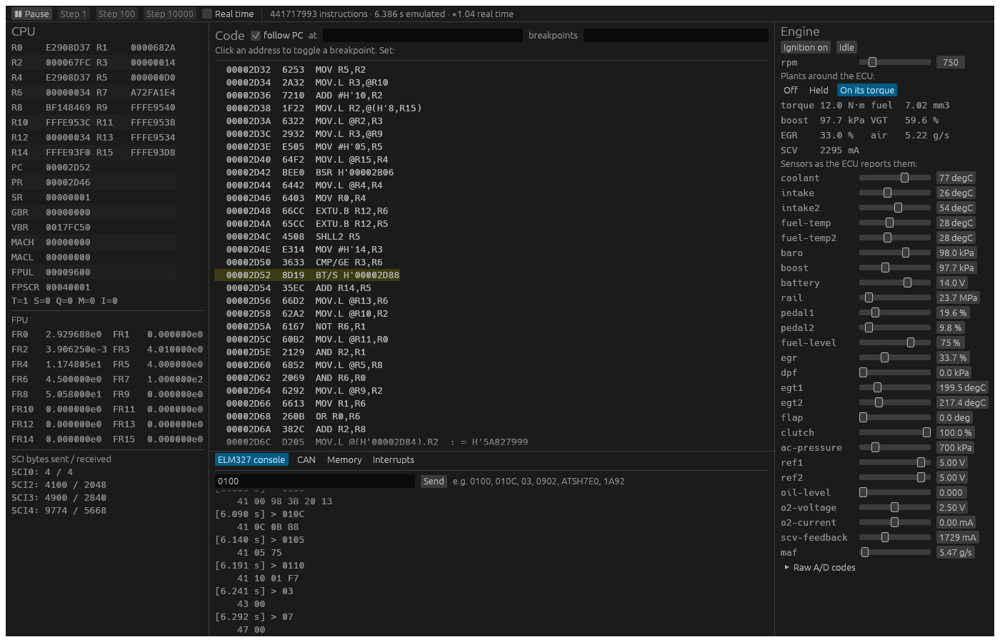

*The Astra's own flash idling at 750 rpm on the simulated engine: the firmware asks for
12.0 N·m and 7.02 mm³ per stroke, holds the EGR at 33 % for 5.2 g/s of fresh air and the
SCV at its setpoint (right), and answers OBD requests from the ELM327 console (bottom),
with no fault pending (`03` and `07` empty). Left, the CPU; centre, the code it is
running.*

## Goals

- **Diagnostics:** talk to the emulated ECU over its emulated CAN bus with ordinary
  diagnostic tools, starting with an ELM327 bridge.
- **Calibration testing:** run the same scenario against two flash images and compare
  what the ECU does.
- **Your own ECU:** load a flash dump (1.5 MB) and an EEPROM dump (8 KB) of a specific
  unit.
- **Engine behaviour:** close the loop with a simulated engine — crankshaft and camshaft
  signals, sensors, actuators — and watch injection, EGR, boost and rail pressure respond.

## Status

| Phase | What | State |
|---|---|---|
| 0 | Boot in Ghidra's p-code emulator: find where the firmware waits on hardware | done |
| 1 | SH-2E core (integer and FPU) and memory map, in Rust | done |
| 2 | Interrupt controller and on-chip peripherals (ATU-II, CMT, WDT, DMAC, SCI, A/D, HCAN) | done for what this firmware uses: INTC, CMT, DMAC, SCI, A/D, HCAN-II, and the ATU-II's input captures, tooth channel, one-shot pulses and PWM outputs. The WDT is not modelled: the firmware leaves it stopped at boot |
| 3 | The Denso board: EEPROM, external chips, pin-to-sensor map | done for what the firmware checks: the four EEPROMs (their order checked), the status chips that watch the output stages, the injector driver on SCI0, the fault lines; 25 of the 32 analog inputs named |
| 4 | Diagnostics over the emulated CAN bus | done: OBD and GMLAN through an ELM327 on TCP and an emulated Scanmatik SM3 |
| 5 | Simulated engine | done up to injection: crank and cam wheels, sensors in physical units, the car's other nodes on the bus, plants for the SCV, EGR, fresh air and turbocharger, and the crankshaft on the firmware's torque. Injection stays off: the immobilizer's other side is not emulated, by choice |
| 6 | Validation against a real ECU, with an FPGA-driven bench | half done: the car's recorded diagnostic answers come back from the emulator with the same shape, 108 of 231 byte for byte, the rest differing only in live values and counters (T-6.1). The FPGA bench driving a real ECU (T-6.2) needs an ECU on the bench: not started |
| 7 | Calibration comparison and map-access tracing | done: setpoints over a speed × pedal grid on the plants, two images compared; the maps looked up in a scenario, named |
| 8 | The ECU on an FPGA (SH-2 soft core with an SH-2E FPU) | not started: the next hardware project (J-core J2 on the KV260, the FPU in RTL) |

### Phase 0 in short

On the Astra dump, Ghidra's p-code emulator runs from reset to the firmware's
background loop, with interrupts enabled, in 2.44 M instructions and with no
peripheral modelled. On the way it busy-waits on a hardware status bit 19 times: the NMI
pin, SCI transmit status, DMA end, A/D end and ATU-II compare flags. Beyond that point
nothing happens without timer interrupts. Ghidra executes about 37,000 instructions per
second, which makes it a reference oracle rather than an emulator.

### Where it stands

- **Core:** every SH-2E instruction, delay slots, exceptions and interrupts, and an FPU
  that rounds toward zero exactly. Checked against Ghidra's disassembler on all 65,536
  codes, against an exact rational oracle for the FPU, and by mutation testing.
- **The Astra's boot** makes the same 196,669 register accesses as Ghidra's emulator,
  from reset to the background loop.
- **With the CMT and the interrupt controller**, the firmware takes its 1 ms tick and
  starts its periodic work: A/D conversions, CAN mailboxes, serial traffic.
- **With the DMAC, SCI, A/D and ATU-II modelled**, the firmware boots and runs with no
  status bit forced: it passes its timer self-tests, fills RAM by DMA, and takes compare
  match interrupts from the ATU-II as it runs.
- **The board's EEPROM** is four 93C86 Microwire chips on the synchronous serial ports,
  each with its own chip select; the firmware reads all four at boot. A PCMflash dump
  can be served as it is.
- **On CAN,** with the ignition input up, the firmware broadcasts its periodic GMLAN
  frames and answers diagnostic requests: OBD modes 01, 03 and 09 (the VIN, over
  ISO-TP), and GMLAN service 1A. The VIN it returns is the car's.
- **The engine turns:** a 60-4 crank wheel and a 4+1 cam wheel on the ATU-II's input
  captures, and the ECU reports the speed it is set to, steadily from idle to 4500 rpm.
  The sync tooth has to come 15 to 45 crank degrees before a main tooth for the
  firmware to keep in sync; where it is on the real engine is not known.
- **Sensors in physical units:** for each analog input, the curve the firmware itself
  applies, measured on the emulated ECU, turns a value (coolant 90 degC, rail 35 MPa,
  boost 180 kPa) into the code that makes the ECU report it. The boost sensor is
  ratiometric to one of the two 5 V references, which the firmware checks. The MAF is
  a frequency on TI0C. The defaults are the car's own values at warm idle.
- **Other nodes on the bus:** of the 20 identifiers the firmware listens to, the ABS
  frame is the one whose absence it reports (U0121); it is sent by default, and `--peers
  car` adds the rest of the car as it sends standing still (not the VIN).
- **Debugging:** memory watchpoints, PC breakpoints and single stepping in the core,
  and a disassembler; in the window, a step at a time, a crank tooth or an input edge at
  a time, and slow motion down to a thousandth of real time.
- **The maps, as the firmware reads them:** every lookup traced without stopping the
  ECU, each map drawn from its own descriptor with where the firmware is on it, where its
  inputs come from and where its result goes; checked on every lookup against the
  firmware's own result.
- **Plugins:** WebAssembly modules beside the ECU, in a sandbox: nodes on its bus,
  readers of its memory; installed from a file or from a repository of your own with
  its token (see [Plugins](#plugins)).
- **On a phone:** an Android app (Kotlin, Compose) runs the same core and draws the
  engine view: the Astra's flash idles on its own torque there as on the desktop.
- **Checked against the car:** the 204 answers of a diagnostic sweep of the car's engine
  and its 27 GMLAN identifiers come back with the same shape; 108 are the same byte for
  byte, the rest are live values, injection, the immobilizer, or counters the EEPROM
  holds from the day it was read.
- **Speed:** with the EEPROM, CAN and the engine turning, the emulated ECU runs 1.26 to
  1.36 times faster than real time (about 90 M instructions per second, i7-10870H);
  the SH7059 runs at 80 MHz, about 69 M instructions per second of ECU time. Flash is
  decoded once, and flash and RAM accesses take a direct path.
- **The engine runs on the firmware's torque** (`sh705x plant`): a simulated crank turns
  with the torque the firmware asks for, and its idle governor settles at 750 rpm, 12 N·m
  and 7.0 mm³ a stroke, as the car does at warm idle. The SCV current loop and the EGR,
  through an air-mass loop, close against plant models from power-on: the EGR settles a
  third open for 5.2 g/s of fresh air, as in the car.
- **The turbocharger:** the VGT (7A) and the boost the car makes for each speed and fuel;
  the firmware's boost loop closes on it (`sh705x plant --sensor pedal=30`).
- **The board's output monitors:** the status chips the firmware reads on SCI3 and SCI4
  and two fault lines on port J are modelled, so its output stage checks pass: no fault
  is pending at idle, with or without the EEPROM.
- **Not yet:** the ECU injects nothing while the immobilizer, whose other side is not
  emulated, keeps it shut; with the car's EEPROM it also raises the idle to 1000 rpm for
  it (P160D). The swirl flaps are driven open loop and their setpoint stays at 0 for what
  the simulated engine asks. What can be modelled without injection is, from the
  firmware's own demands.

## Layout

| Path | Contents |
|---|---|
| `crates/sh2e` | SH-2E core: registers, reset, and the `Bus` trait it runs against |
| `crates/sh7059` | The SH7059: address map, flash, RAM, register area, peripherals (INTC, CMT, DMAC, SCI, A/D, ATU-II, HCAN-II), debugging aids, and `Machine`, which runs CPU and chip on one clock |
| `crates/board` | The ECU board: the four 93C86 EEPROMs, the output status chips and fault lines, and how they are wired |
| `crates/engine` | The simulated engine: crank and cam wheels, sensors with the firmware's A/D curves, the MAF, periodic frames of other CAN nodes |
| `crates/bridge` | The CAN bus as a diagnostic tool sees it, in virtual or real time; ISO-TP; an ELM327; a TCP server; an emulated Scanmatik SM3 |
| `crates/j2534` | `sh705x_j2534.dll`: a J2534 pass-thru DLL whose adapter is the emulated SM3, for GDS2 and other Windows tools; ISO 15765 on this side |
| `crates/sh705x` | Command-line front end |
| `crates/session` | The ECU as an interactive front end drives it: wired into its car, the plants around it, run a slice, a tooth or an edge at a time, the history the engine view draws, and the maps it reads (traced, decoded, their call sites read, their inputs named) |
| `crates/gui` | `sh705x-gui`: a load screen for the images, then registers, code with breakpoints, memory, CAN, interrupts, the engine (speed, sensors in physical units, and the plants) and an ELM327 console, live (egui) |
| `crates/plugins` | Plugins: WebAssembly modules in a sandbox, on the ECU's bus and in its memory; installed from a file or from a source with its own token |
| `plugins/` | Writing plugins: the Rust SDK (`sh705x-plugin`), an example, and the guide |
| `crates/android` | The Android app's native side: the ECU on its own thread behind a JNI bridge (`libsh705x_jni.so`) |
| `android/` | The Android app: Kotlin and Compose, the engine view on a phone |
| `tools/bench.py` | Interleaved speed comparison of builds |
| `tools/gen_curves.py` | Generates `crates/engine/src/curves.rs` from a sweep of the A/D inputs |
| `tools/ghidra/EmuBoot.py` | Phase 0: runs a raw flash image from its reset vector in Ghidra's p-code emulator, logs every I/O access and resolves status-bit polls automatically |
| `tools/ghidra/emu_boot.ps1` | Runs `EmuBoot.py` headless in a throwaway project |

## Download

Each [release](https://github.com/PabloSoage/sh705x-emu/releases) carries:

- `sh705x-<version>-windows-x86_64.zip`: `sh705x-gui.exe`, the window, and `sh705x.exe`,
  the command line. Both carry their C runtime, so they run on any 64-bit Windows with
  nothing else installed.
- the Android app, one APK per ABI: `arm64-v8a` for phones, `x86_64` for the Android
  emulator and x86 devices.

No firmware comes with any of them: bring your own dump.

## Building and running

```sh
cargo build --release
cargo run --release -p sh705x -- info --flash <flash.bin> --eeprom <eeprom.bin>
```

`info` loads both images, checks their sizes, prints the reset vectors with the region
each one points into, and the CPU state after a power-on reset. `trace` runs the
firmware and writes every peripheral register access; `disasm` disassembles the flash;
see `sh705x help`.

### Talking to the emulated ECU

```sh
# Boot it and send ELM327 commands, in virtual time (deterministic, no wall clock):
sh705x obd --flash <flash.bin> --eeprom <eeprom.bin> 0100 0902 ATSH7E0 1A92

# Run it in real time and serve an ELM327 on 127.0.0.1:35000 for diagnostic apps:
sh705x serve --flash <flash.bin> --eeprom <eeprom.bin>
```

For [opendash](https://github.com/PabloSoage/opendash), which talks to a Scanmatik SM3
rather than an ELM327, there is an emulated SM3: run

```sh
sh705x sm3 --flash <flash.bin> --eeprom <eeprom.bin>
```

and set opendash's adapter address to this machine's IP (port 777), on the same
network.

Windows tools that speak J2534 (GDS2, PCMflash…) reach the same emulated SM3 through
`sh705x_j2534.dll` (`crates/j2534`), a pass-thru DLL of its own: the vendor's DLL pairs
with the physical adapter over Wi-Fi Direct, Bluetooth or USB and takes no address.
Build it for the application's bitness (GDS2 is 32-bit) and register it, as
administrator, on the machine or virtual machine where the application runs:

```powershell
cargo build --release -p j2534 --target i686-pc-windows-msvc
.\crates\j2534\register.ps1 -Dll32 target\i686-pc-windows-msvc\release\sh705x_j2534.dll -Server <emulator-ip>:777
```

The application then lists "sh705x emulated SM3" next to real adapters. It carries
CAN and ISO 15765 on the high-speed bus (flow-control, pass and block filters, extended
addressing, padding, loopback, periodic messages). `log=<file>` in
`%ProgramData%\sh705x\j2534.ini` records every call and frame.

To watch it run, start `sh705x-gui` (on Windows, the `.exe` from a release runs as it is,
with no runtime to install). It opens on a load screen: choose the flash image and, if you
have it, the EEPROM image with the system's file dialog, type their paths, or drop the
files onto the window; set the EEPROM layout if your dump is not a PCMflash one as it is,
and power on. "⏏ Images…" powers off and goes back there. The same can be given on the
command line, and then it powers on straight away:

```sh
cargo run --release -p gui -- --flash <flash.bin> --eeprom <eeprom.bin> [--eeprom-layout 0123[le]]
```

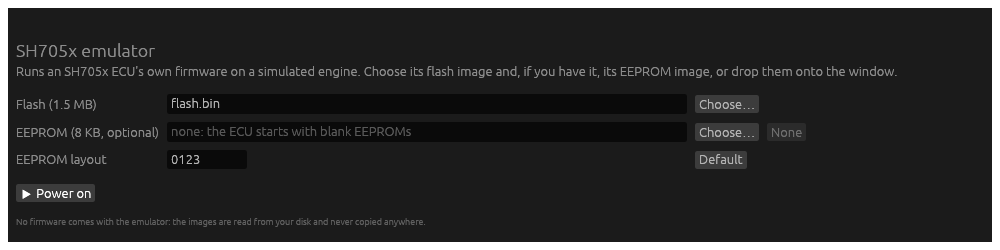

In the engine panel, "Plants" puts the plants around the ECU: "Held" closes the SCV,
EGR, fresh air and turbocharger loops at the speed set there; "On its torque" also lets
the engine turn on the firmware's torque, as `sh705x plant` does.

To watch it act step by step: pause, then "Step 1" runs one instruction, "Next tooth"
turns the crankshaft to its next tooth position (6°) and "Next edge" to the next edge on
any input pin (crank, cam or MAF), each stopping at a breakpoint on the way. With "Real
time" on, the speed box slows the whole ECU down to ×0.1, ×0.01 or ×0.001: at idle, a
tooth about every second. The engine panel shows the crank angle over the 720° of a cam
cycle, the tooth, and the next input edge.

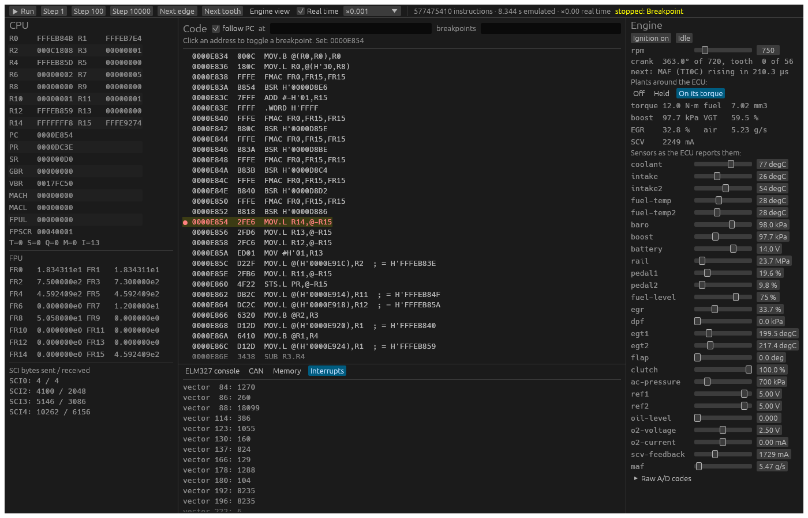

*Stopped at a breakpoint on 0xE854, the routine the firmware runs at the first tooth after
the gap (crank at 363°, tooth 0), slowed to ×0.001, ready to step.*

"Engine view" opens a window with the engine drawn and its history in ECU time: the crank
and cam wheels turning under their sensors, the four cylinders (their phase to the crank
is assumed), and strip charts of what the firmware asks for against what the plants give
back: engine speed, EGR asked, position and drive, boost, the VGT and SCV commands and the
SCV current, rail pressure, fresh air, fuel and torque asked. Under them, the crank and cam
signals and the one-shot pulses of the ATU-II's channel 8, where the injectors are
(TO8I–L; they never pulse here: the immobilizer cuts injection). The window goes from 10
ms to 20 s; the pointer reads every chart at one instant. Slowed down or a tooth at a time,
the fast moves show, such as each step of the EGR's drive.

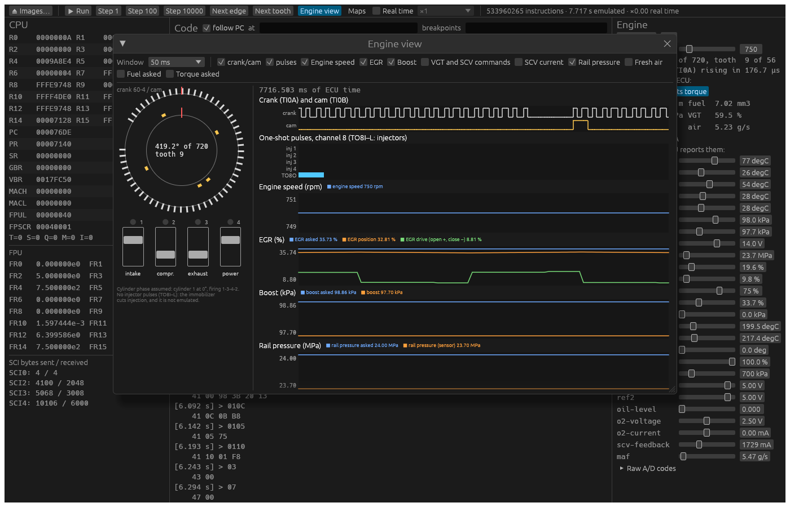

*50 ms at idle: the 60-4 crank wheel with its gap, the cam's sync and main pulses, the EGR
held at a third open by a drive that steps every few milliseconds, boost and rail.*

"Scope" is an oscilloscope on the ECU's pins: the crank, cam and MAF inputs, the PWM
outputs of ATU-II channels 6 and 7 (SCV, throttle, VGT, swirl flaps, EGR), and the one-shot
outputs of channel 8, where the injectors are. An input edge is drawn at the cycle the chip
took it, and a PWM output from its timer's counter, period and duty: exact between register
changes, which are placed when the emulator next looks (half a millisecond at most in real
time). Time base from 10 µs to 50 ms a division, a trigger on either edge of any channel
(auto, normal or single, with how much of the window comes before it), hold, a cursor that
reads the time from the trigger, and each channel's frequency, period and duty.

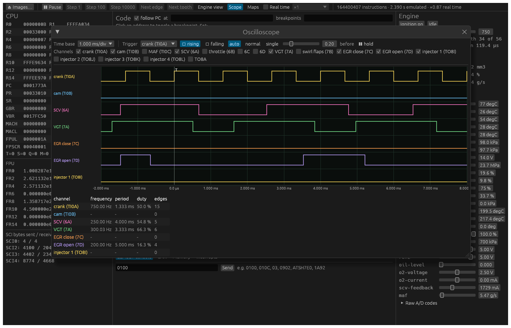

*At idle, 1 ms a division, held on the crank's rising edge: the crank at 750 Hz (60 teeth at
750 rpm), the SCV's PWM at 250 Hz, the VGT's at 300 Hz and the EGR's opening drive at
200 Hz, each with its duty.*

"Maps" opens the calibration maps the firmware reads, as it reads them. Denso firmware
looks its maps up through a few interpolation routines that take the map's descriptor in
R4; the emulator finds those routines in the flash by itself (0x7128 and 0x70B4 on the
Astra, as Ghidra found them), probes them without stopping the ECU (about 6 % slower
while the window is open), and draws each map whole from its own descriptor, in physical
units: as a heat map, a surface to turn, a table, or a curve, with where the firmware is
on it now and where it has just been. On the Astra at idle it reads 594 maps, 18 352 times
in half a second, and on every lookup the result the firmware gets is the decoded map's
interpolation.

For each map it shows where it is read from (a link to the code), where each input comes
from and where the result goes, read from the code around the call: a variable, the
result of a routine (the engine speed), or another map, which is a link to that map; and
which maps read its result. "Stop at its next lookup" runs the ECU and stops where the
firmware next reads that map, to go on an instruction or a tooth at a time.

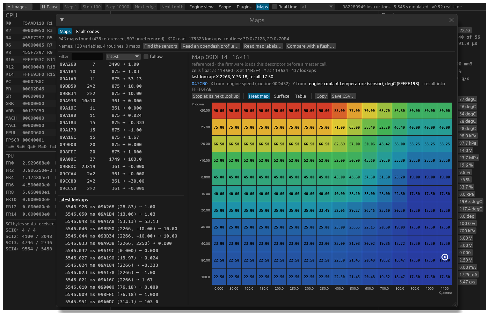

*A 16×11 map read at engine speed (from the firmware's own engine speed routine) and
coolant temperature (found by moving the sensor), with the lookups as they come on the
left. The list names a map by what its result becomes: "gives torque asked".*

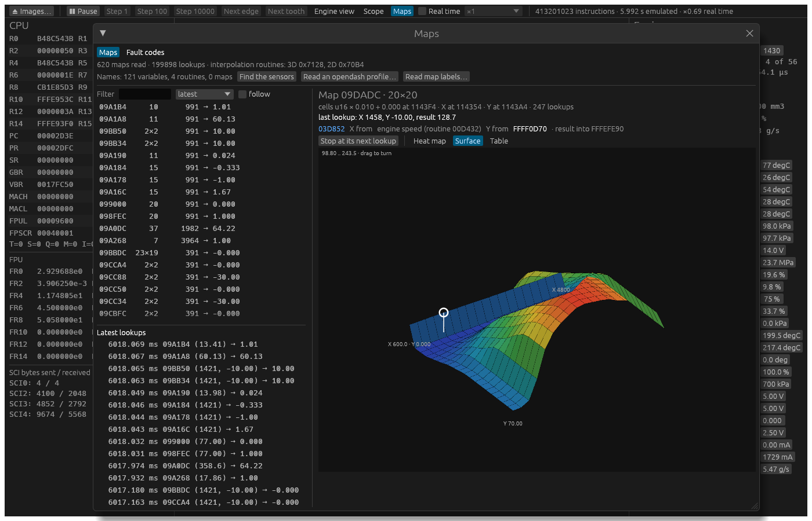

*The boost target (20×20) as a surface, at idle.*

Names come from three places:

- **With the emulator:** what this project found in the Astra's calibration, used only
  when the flash is that calibration, and "Find the sensors", which moves every sensor and
  names the variables that follow it.
- **From your own files, at run time:** "Read an opendash profile…" takes a parameter
  profile (opendash's `profiles.txt`); the emulated ECU is asked for each identifier in
  three engine states, and the variable that holds the answer every time takes its name.
  "Read map labels…" takes labels by descriptor. Neither is kept with the emulator: such
  catalogues are often someone else's data, and stay on your disk.

The same window has the calibration's fault codes, on the Astra's: the 202 codes as the
flash holds them, enabled or disabled (tables A and C both 0 disable one, as a workshop
file does), what the ECU does while one is active, and their tests live. Every test reports
through one routine with the code's index and its result, so the emulator probes it too:
how often each code is tested, how often its test fails, which codes the ECU reports
(modes 03 and 07), where each is tested, which maps that test reads, and "Stop at its next
test". At idle 193 of the 202 are tested; with the DPF sensor at the top
of its range, P2455's test starts failing and the ECU reports the code. Descriptions come
with the emulator for the codes this project has met; your own file can add the rest.

A failed test is not yet a fault. Each code lists up to three conditions, each a flag in
RAM, and the ECU counts a result only while they are all met: the routine that counts it is
probed as well, so the page says how many results counted and which conditions are met now.
P0101's test runs at idle and fails there, but its results count only between 1500 and
4000 rpm, so at idle it never becomes a code.

The tables are not looked up by calibration: they are found in the flash from the code
that reads them (the routine that counts a result loads tables A, B and C; the one that
calls it is the reporter; the codes are the table of that length that looks like codes
and is loaded from the most places). On the
Astra's flash the search finds what this project found by hand; on other calibrations it
has not been tried.

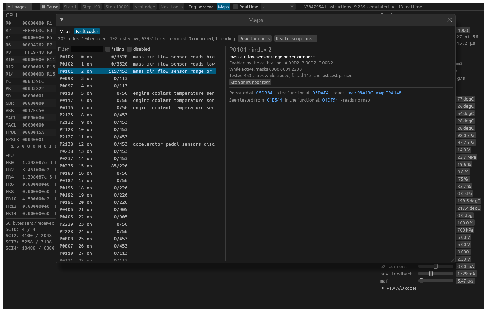

*The DPF sensor at the top of its range and the codes read (P2455 pending, further down).
P0101's test reads two maps, each a link to the map; it has failed 115 times and none
counted, because its condition 1 (1500 to 4000 rpm among others) is not met at idle.*

### Plugins

The emulator runs plugins beside the ECU: WebAssembly modules, each in a sandbox with a
budget of work per call. A plugin hears every frame the ECU sends on its CAN bus and can
put frames of its own on it, as another node of the car would. It reads the memory its
manifest names and can write RAM. It cannot reach the network or the disk.

The same `.wasm` runs in the Windows program and the Android app. Install it from a file,
or from a source: a repository of your own (GitHub, GitLab, Gitea) with a token scoped to
it, or any HTTPS directory, each with its own token, as opendash does with its catalogues.
A plugin can stay in a private repository and never be published.

How to write one, the API and how to publish them: [`plugins/README.md`](plugins/README.md).
`plugins/abs-node` is an example: it stands in for the ABS on the bus. On the Astra's
flash and EEPROM with no other node, the ECU reports U0121 (no ABS) after seven seconds;
with the plugin loaded it does not, and the plugin reads its engine speed.

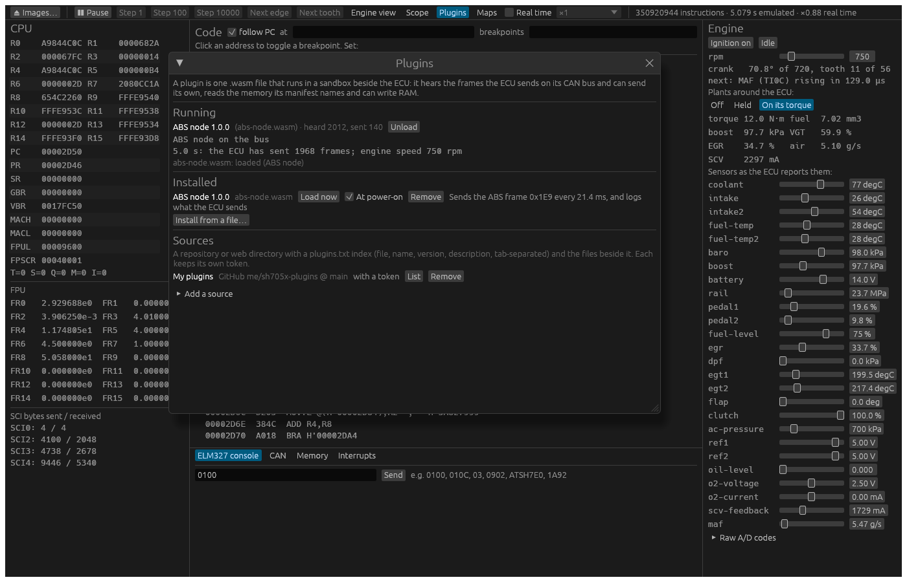

*The example plugin running at idle (5 s in, the ECU has sent it 1968 frames, and it
reads 750 rpm), installed and loaded at power-on, and a private source on GitHub.*

| CAN traffic | Memory |
|---|---|
| 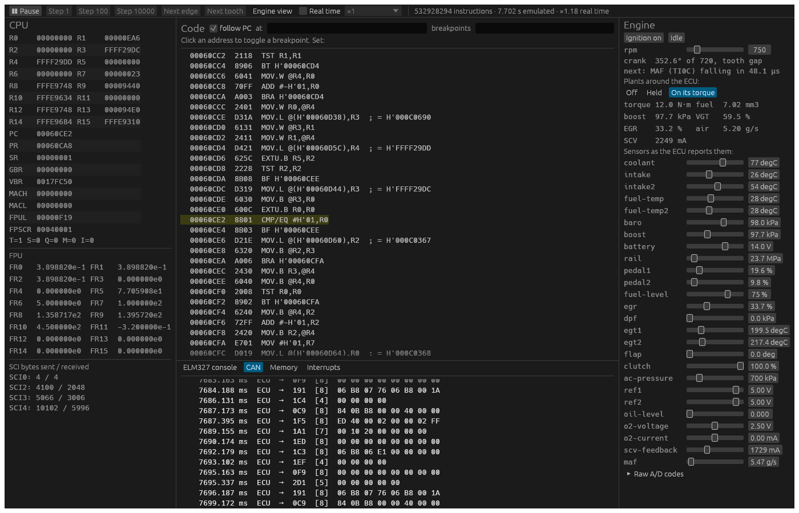 | 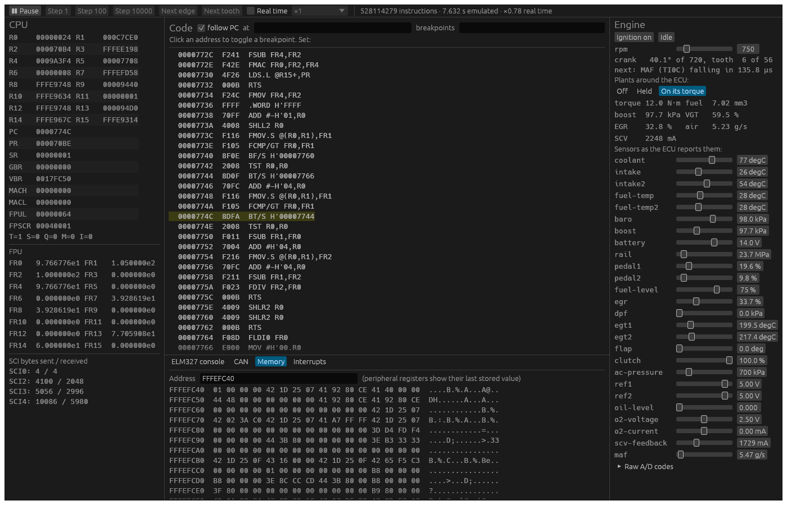 |
| The ECU's frames (grey) among the ABS node's (green), with their virtual time. Tool frames show in blue. | RAM, live: at `FFFEFC4C`, `41 40 00 00` is the torque the firmware asks for, 12.0 N·m as a float. |

The pictures come from a test that draws the window with no screen, on the flash given
in `SH705X_FLASH` (no EEPROM, so no VIN in them):

```sh
cargo test -p gui --release -- --ignored screenshots
```

All of them turn the ignition input on (`--adc 14:600`); without it the firmware stays
silent on CAN. Frames from the tool reach the ECU after their time on a 500 kbit/s bus,
as on the car: the firmware drops a flow control that comes back faster than that.

The engine and its sensors:

```sh
# Idling at 750 rpm, sensors at the car's warm idle values, the ABS on the bus:
sh705x obd --flash <flash.bin> --eeprom <eeprom.bin> --rpm 750 010C 0105 07

# Any sensor in physical units (an unknown key lists them), or a raw A/D code:
sh705x serve --flash <flash.bin> --eeprom <eeprom.bin> --rpm 2000 --sensor coolant=90 --sensor maf=40

# An output stage at fault, as its status chip reports it (SCI4, chip on PD6: the
# throttle motor, P2103); or a sensor out of range (AN11, the DPF sensor, at 1023: P2455):
sh705x obd --flash <flash.bin> --rpm 750 --boot 875000000 --status 4.1=FF 07
sh705x obd --flash <flash.bin> --rpm 750 --boot 875000000 --adc 11:1023 07

# How fast it runs against real time, with the engine turning:
sh705x bench --flash <flash.bin> --eeprom <eeprom.bin> --rpm 800
```

`--sensors off` leaves every analog input at code 0 and `--peers none` takes the ABS
off the bus.

### On Android

The engine view also runs on a phone: `android/` is an app in Kotlin and Compose over the
same core, built into `libsh705x_jni.so` (`crates/android`) and driven as the window
drives it, on a thread of its own. Pick the flash dump (and the EEPROM, if you have it)
with the system's file picker; the app ships no firmware and keeps the dumps in memory
only. Its one network permission is for the plugin sources you add and for looking up a
new release. "Idle on its torque" sets the car's warm idle, puts the
plants around the ECU and lets the engine turn on the firmware's torque; slow motion,
"Next tooth" and "Next edge" work as in the window. It starts in a dark theme; light, or
the system's, is a tap away.

| The engine | Its history |
|---|---|
| 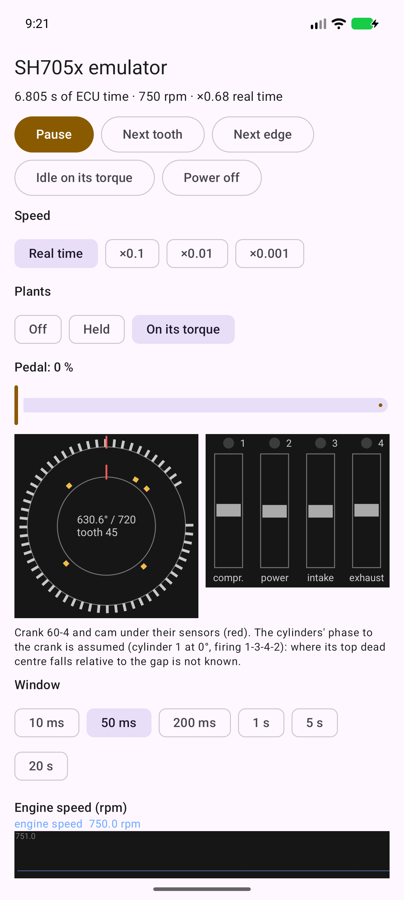 | 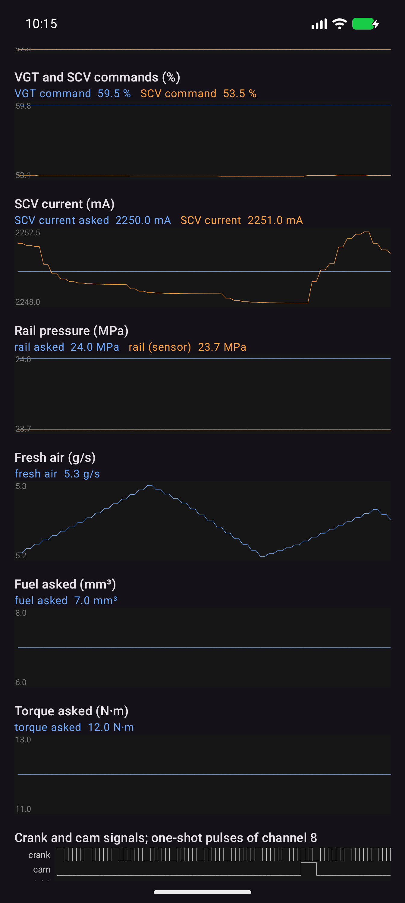 |
| The Astra's flash idling at 750 rpm on its own torque (Android emulator, x86_64). | SCV current on its setpoint, rail asked 24 MPa, 5.2 g/s of fresh air, 7.0 mm³ and 12 N·m asked; the crank signal with its gap and the cam's pulses. |

The maps are there too, under "Maps": the same list, the map drawn from its descriptor
with where the firmware is on it, where each input comes from and where the result goes,
the sensors found by moving them, and an opendash profile or map labels read from the
phone's storage.

| Fault codes | Oscilloscope |
|---|---|
| 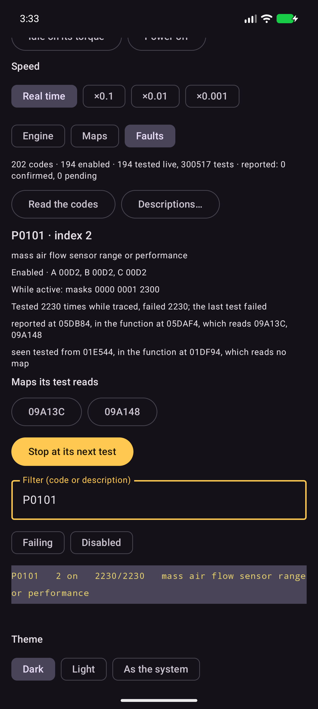 | 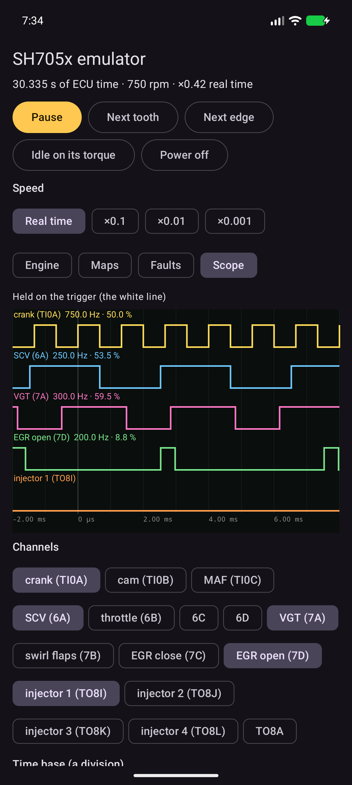 |
| The "Faults" tab: every code with its tests live, how many the ECU counted and which of its conditions are met, which codes the ECU reports, its tables, where it is tested and the maps its test reads. | The "Scope" tab: the pins as waveforms, held on an edge, with each channel's frequency and duty. |

| Plugins | Updates |
|---|---|
| 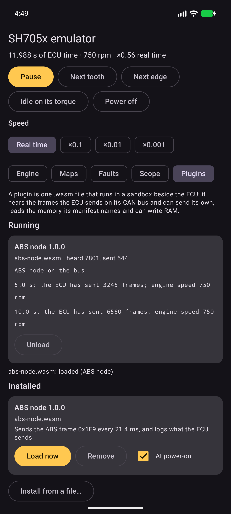 | 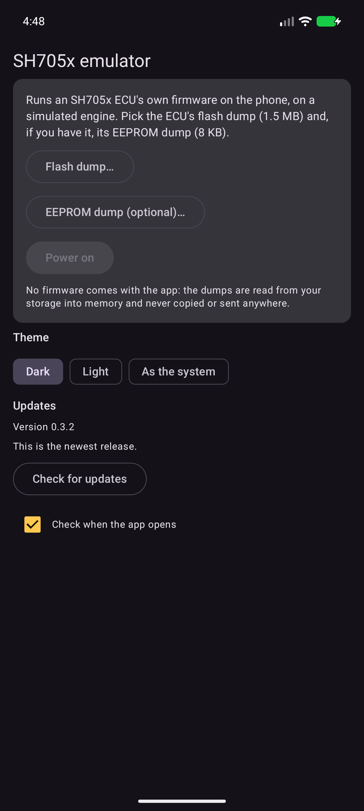 |
| The "Plugins" tab: the same `.wasm` as on Windows, installed from a file or from a source with its token, loaded now or at every power-on, with its log. | As opendash does: the app looks up the newest release on GitHub when it opens (that can be turned off), shows its notes, downloads the APK for the phone's ABI and hands it to an installer you choose. |

| A map | As a surface |
|---|---|
| 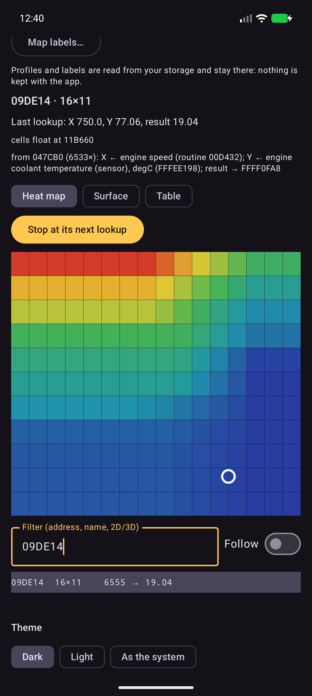 | 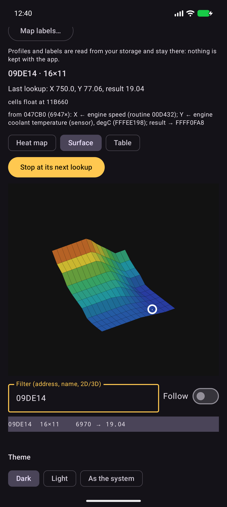 |
| Read at engine speed (the firmware's own routine) and coolant temperature (found by moving the sensor), the firmware at 750 rpm and 77 °C. | The same map as a surface, turned with a finger. |

Building it needs the Android SDK with NDK 29.0.14206865, JDK 21 (Gradle provisions
Corretto 21 for Kotlin), [cargo-ndk](https://github.com/bbqsrc/cargo-ndk) and the two Rust
targets; Gradle runs `cargo ndk` before it packs the native libraries:

```sh
rustup target add aarch64-linux-android x86_64-linux-android
cargo install cargo-ndk
cd android
./gradlew :app:assembleDebug    # app/build/outputs/apk/debug/app-{arm64-v8a,x86_64}-debug.apk
```

There is one APK per ABI: `arm64-v8a` for phones, `x86_64` for the Android emulator.
`-Psh705x.rust=false` builds without the native side, as CI does.

### Comparing calibrations

```sh
# What the ECU asks for over a grid of engine speed and pedal, and where a second image
# differs: fuel injected and asked for, torque delivered, desired rail pressure, SCV current (measured)
# and duty command, desired air flow and boost, VGT vane command, desired EGR and
# throttle, load.
sh705x maps --flash <original.bin> --compare <modified.bin> --eeprom <eeprom.bin>
```

And which maps the firmware reads in a scenario, through its interpolation routines
(found with the map catalogue's Ghidra tools), with their inputs and results, marking
those a second image changes. With `--labels` each map is also named in words (VNT duty
cycle, target air mass, torque-to-IQ, rail pressure limiters...):

```sh
sh705x touched --flash <original.bin> --compare <modified.bin> --eeprom <eeprom.bin>     --rpm 2500 --sensor pedal=60 --masters 3d=7128,2d=70B4 --catalog <maps-3d.csv> --labels <tags.txt>
```

Each point of `maps` holds the engine at that speed, as on a dyno, while the ECU boots
with the plants around it (EGR, fresh air, SCV, turbocharger), and reads the setpoints
once their loops have settled. They come from the calibration's maps, so a changed map
shows where the engine is on it. As long as the ECU does not inject, the fuel it injects
reads 0; the fuel it asks for, read from RAM, is the number a fuel map change moves.

### Actuators that run without injection

Two of the ECU's loops regulate whatever the fuel cut does: the suction control valve's
current (ATU-II output 6A, read back on AN1) and the EGR valve's position (an H-bridge
on 7D and 7C, read back on AN10). `actuators` powers the ECU on with the engine held at
idle speed, drives a physical plant with the firmware's duties and returns the plant's
output to those inputs every millisecond, so the firmware's own regulators close against
it, and traces the result with the VGT command (7A):

```sh
sh705x actuators --flash <flash.bin> --eeprom <eeprom.bin> --millis 4000
```

The SCV current loop holds its own setpoint (2250 mA asked, 2249 measured). With the
engine held, the idle governor asks for a lot of fuel and the firmware shuts the EGR, as
the car does under load; `plant` lets the speed go and shows the EGR loop at idle.

### The engine on the firmware's own torque

With the immobiliser shut no injector fires, but the firmware still works out the fuel it
wants and the torque that fuel would give. `plant` turns a simulated crankshaft with that
torque, the crank wheel following its speed tooth by tooth, so the firmware's idle
governor and pedal map close their loop through the simulation. Nothing in the firmware
is changed, and nothing here makes a real engine run.

```sh
# Idle (the default), or rev it in neutral with --sensor pedal=30; --load in N·m
sh705x plant --flash <flash.bin> --millis 15000
```

At warm idle it settles at 750 rpm, 12 N·m and 7.0 mm³ a stroke, with the EGR 33 % open
and 5.2 g/s of fresh air: what the car reports standing still. With the car's EEPROM
the firmware also checks the immobilizer, and its reaction raises the idle to 1000 rpm;
the trace shows the target it aims at.

### Tests

```sh
cargo test --all
cargo clippy --all-targets -- -D warnings
cargo fmt --all --check
```

Tests that need a real dump read it from `SH705X_FLASH` (and `SH705X_EEPROM`) and are
skipped when those are not set.

CI (`.github/workflows/ci.yml`) runs those three on Ubuntu, with the latest stable Rust,
on every push to `main` and every pull request, and builds the Android app and runs its
unit tests (without the native side, which the Rust job already covers). No dump is given
to it, so the tests that need one skip themselves there; run them locally with the dumps
before pushing. A tag `v*` builds the Windows programs, checks that they need no Visual C++
runtime (`.cargo/config.toml` links it in) and puts them on a draft release
(`.github/workflows/release.yml`), where the signed Android APKs are added by hand.

The phase 0 tool needs Ghidra 12 (`GHIDRA_INSTALL_DIR` or `-Ghidra`):

```powershell
.\tools\ghidra\emu_boot.ps1 -Flash <flash.bin> -Out boot.report.txt -Max 15000000
```

## Design notes

- **Own interpreter, in Rust.** No existing emulator models the SH-2E: its single-precision
  FPU rounds toward zero only, which neither the host FPU nor Ghidra does by default.
- **Real time is the target.** The emulated ECU should run at least as fast as the real
  one: the SH7059 runs at up to 80 MHz, so up to 80 million instructions per second.
  The core is built for that from the start: the bus is a generic parameter (no dynamic
  dispatch per access), flash and RAM sit on a fast path apart from the peripherals,
  and instructions will be pre-decoded. A phase 8 FPGA port is the route to hard real
  time.
- **Virtual time.** Scenarios run on an event queue and are reproducible bit for bit;
  wall-clock pacing is only used when a real tool is attached to a bridge.
- **Built to be watched.** The core will expose pause, single step and breakpoints, so
  a graphical front end can show registers, peripherals and the engine live.
- **Reference:** *SH-2E SH7059 F-ZTAT, SH7058S F-ZTAT Hardware Manual*, Renesas
  REJ09B0177-0500, Rev. 5.00.

## Firmware

**No firmware is, or will be, in this repository.** ECU flash and EEPROM images are
copyrighted by their manufacturers; bring your own dump. The `.gitignore` refuses the
usual image formats.

This project is for understanding and testing ECUs. It is not a tool for disabling
emission control systems.

## License

Copyright (C) 2026 Pablo Soage Rodas

This program is free software: you can redistribute it and/or modify it under
the terms of the GNU General Public License as published by the Free Software
Foundation, either version 3 of the License, or (at your option) any later
version.

This program is distributed in the hope that it will be useful, but WITHOUT ANY
WARRANTY; without even the implied warranty of MERCHANTABILITY or FITNESS FOR A
PARTICULAR PURPOSE. See the GNU General Public License for more details.

You should have received a copy of the GNU General Public License along with
this program. If not, see <https://www.gnu.org/licenses/>.

**The license covers this repository's own code only.** It does not and cannot
cover any ECU firmware image you run on it.
